<a href="https://www.eliasolguin.dev">
  
</a>

<p align="center">
  
</p>

<p align="center">
  <a href="https://www.eliasolguin.dev"></a>
  <a href="https://www.linkedin.com/in/eliasolguin/"></a>
  <a href="mailto:eliasolguinde@gmail.com"></a>
  <a href="https://www.eliasolguin.dev/Elias-Olguin-CV.pdf"></a>
</p>

---

### `00 / SPEC`

| `KEY` | `VALUE` |
|:--|:--|
| `FRONTEND` | React · TypeScript · JavaScript · Redux |
| `BACKEND`  | C# · .NET · Node · REST |
| `DATA`     | SQL Server · PostgreSQL · MySQL |
| `BASE`     | Cologne, Germany 🇩🇪 · EU citizen · available now |
| `OPEN TO`  | Full-stack roles · remote · relocation |
| `SPEAKS`   | Spanish (native) · English (B2) · German (A1, learning) |

### `01 / STACK`

<p align="left">
  <br>
  
</p>

### `02 / PROJECTS`

<table>
  <tr>
    <td width="50%" valign="top">
      <h4><a href="https://github.com/EliasOlguin/DoneToday">DoneToday</a> &nbsp;</h4>
      <p>Habit tracker: schedule habits, check them off and follow your streaks. EN · ES · DE.</p>
      <p>
        
        
        
      </p>
      <a href="https://donetoday-15xl.onrender.com/">Live ↗</a> · <a href="https://github.com/EliasOlguin/DoneToday">Code ↗</a>
    </td>
    <td width="50%" valign="top">
      <h4><a href="https://github.com/EliasOlguin/recycle-app">recycle-app</a> &nbsp;</h4>
      <p>Photo in, bin out: the right recycling bin for your German city.</p>
      <p>
        
        
        
      </p>
      <a href="https://github.com/EliasOlguin/recycle-app">Code ↗</a>
    </td>
  </tr>
</table>

### `03 / PATH`

```text
2020 ── Brazing welder ······ Newsan · Ushuaia
2021 ── Repair technician ··· Newsan · Ushuaia
2022 ── Software developer ·· Newsan · Ushuaia   → traceability system in 6 factories
2024 ── Move to Germany ····· Italy · Cologne    → EU citizenship, personal projects
```

### `04 / ACTIVITY`

<p align="center">
  
  
</p>
<p align="center">
  
</p>

<p align="center">
  
</p>

<p align="center"><sub><code>Let's build something.</code> · <a href="https://www.eliasolguin.dev">eliasolguin.dev</a></sub></p>
